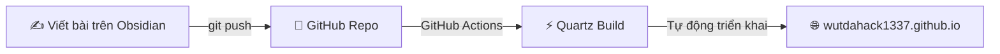

# wutdahack's Digital Garden & Blog 🌱

Trang blog và khu vườn tri thức số cá nhân của **Trần Quang Minh** (`wutdahack`).

Được xây dựng trên nền tảng **Quartz v4**, tối ưu hóa hoàn hảo cho **Obsidian** và tự động triển khai lên **GitHub Pages**.

---

## 🚀 Luồng hoạt động (Workflow)



1. **Viết bài**: Mở thư mục `content/` (hoặc toàn bộ repo này) bằng **Obsidian** và soạn thảo các file Markdown (`.md`).
2. **Đẩy lên GitHub**: Lưu bài và `git push` lên nhánh `main`.
3. **Xem bài viết**: GitHub Actions sẽ tự động biên dịch và đăng bài lên [wutdahack1337.github.io](https://wutdahack1337.github.io) trong khoảng 30–60 giây.

---

## ⚙️ Cài đặt một lần duy nhất trên GitHub

Để GitHub Pages kích hoạt quy trình tự động triển khai qua GitHub Actions:

1. Truy cập repo trên GitHub: `https://github.com/wutdahack1337/wutdahack1337.github.io`
2. Chọn tab **Settings** (Cài đặt) -> chọn mục **Pages** ở thanh bên trái.
3. Ở phần **Build and deployment** > **Source**, đổi từ *Deploy from a branch* sang **GitHub Actions**.

---

## 📂 Cấu trúc thư mục

- `content/`: **Thư mục quan trọng nhất** — đây là nơi bạn viết và quản lý các ghi chép bằng Obsidian.
  - `content/index.md`: Nội dung trang chủ blog.
  - `content/about.md`: Trang giới thiệu bản thân.
  - `content/posts/`: Thư mục chứa các bài viết chia sẻ, cảm nghĩ, review sách...
  - `content/images/`: Nơi lưu trữ hình ảnh minh họa cho bài viết.
- `quartz.config.ts`: Cấu hình tên trang, ngôn ngữ (`vi-VN`), giao diện, phông chữ và liên kết.
- `.github/workflows/deploy.yml`: File cấu hình GitHub Actions tự động build website.

---

## ✍️ Hướng dẫn viết bài mới trong Obsidian

### 1. Tạo file bài viết mới
Tạo một file `.md` bên trong thư mục `content/posts/` (ví dụ: `content/posts/ten-bai-viet.md`).

### 2. Định dạng đầu bài (Frontmatter)
Thêm khối frontmatter ở đầu file để đặt tiêu đề, ngày đăng và các thẻ (tags):

```markdown
---
title: "Tiêu đề bài viết của bạn"
date: 2026-10-22
tags:
  - sach
  - suy-nghi
  - lap-trinh
---
```

### 3. Các tính năng Obsidian được hỗ trợ tự nhiên
- **Liên kết nội bộ (Wikilinks)**: Dùng cú pháp `[[Tên bài viết]]` hoặc `[[Đường dẫn|Tên hiển thị]]`.
- **Hộp ghi chú (Callouts)**:
  ```markdown
  > [!info] Tiêu đề thông tin
  > Nội dung cần làm nổi bật.

  > [!quote] Danh ngôn
  > Những câu trích dẫn yêu thích.

  > [!tip] Mẹo hay
  > Gợi ý hữu ích.
  ```
- **Chèn ảnh**: Dùng cú pháp `![[anh.jpg]]` hoặc ``.
- **Thẻ (Tags)**: Dùng `#the-cua-ban` hoặc khai báo trong frontmatter để tự động gom nhóm bài viết.
- **Công thức Toán học (KaTeX)**: Kẹp công thức giữa dấu `$...$` hoặc `$$...$$`.
- **Sơ đồ Mermaid**: Dùng khối mã ```mermaid để vẽ sơ đồ tư duy hoặc lưu đồ.

---

## 🔄 Cách xuất bản bài viết

### Cách 1: Dùng plugin Obsidian Git (Khuyên dùng - Nhanh nhất)
1. Trong Obsidian, vào **Settings** -> **Community plugins** -> tìm và cài đặt **Obsidian Git**.
2. Thiết lập phím tắt hoặc mở Command Palette (`Ctrl + P`), gõ `Git: Commit and sync`.
3. Obsidian sẽ tự động commit và push mọi thay đổi lên GitHub mà không cần mở terminal!

### Cách 2: Dùng Git Terminal thông thường
```bash
git add .
git commit -m "Thêm bài viết mới"
git push
```

---

## 💻 Xem trước tại máy cục bộ (Tùy chọn)

Nếu bạn muốn chạy thử nghiệm website trên máy trước khi push:

```bash
# Cài đặt thư viện (chỉ cần chạy lần đầu)
npm install

# Chạy server xem trước tại http://localhost:8080
npx quartz build --serve
```
