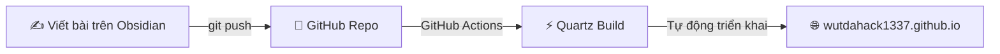

# wutdahack's Digital Garden & Blog 🌱

Trang blog và khu vườn tri thức số cá nhân của **Trần Quang Minh** (`wutdahack`).

Được xây dựng trên nền tảng **Quartz v4**, tối ưu hóa hoàn hảo cho **Obsidian** và tự động triển khai lên **GitHub Pages**.

---

## 🚀 Luồng hoạt động (Workflow)



1. **Viết bài**: Mở thư mục `content/` (hoặc toàn bộ repo này) bằng **Obsidian** và soạn thảo các file Markdown (`.md`).
2. **Đẩy lên GitHub**: Lưu bài và `git push` lên nhánh `main`.
3. **Xem bài viết**: GitHub Actions sẽ tự động biên dịch và đăng bài lên [wutdahack1337.github.io](https://wutdahack1337.github.io) trong khoảng 30–60 giây.

---

## ⚙️ Cài đặt một lần duy nhất trên GitHub

Để GitHub Pages kích hoạt quy trình tự động triển khai qua GitHub Actions:

1. Truy cập repo trên GitHub: `https://github.com/wutdahack1337/wutdahack1337.github.io`
2. Chọn tab **Settings** (Cài đặt) -> chọn mục **Pages** ở thanh bên trái.
3. Ở phần **Build and deployment** > **Source**, đổi từ *Deploy from a branch* sang **GitHub Actions**.

---

## 📂 Cấu trúc thư mục

- `content/`: **Thư mục nội dung** — quản lý toàn bộ ghi chép của bạn.
  - `content/draft/`: **Bản thảo dở dang (Drafts / Seedlings)** — nơi chứa các ý tưởng sơ khai đang hình thành theo tinh thần *"Work with the garage door up"*.
  - `content/posts/`: **Ghi chép & Bài viết hoàn chỉnh (Notes)** — các bài viết và ghi chép đã hoàn thiện.
  - `content/index.md`: Trang chủ Khu Vườn Ghi Chép (Working Notes), luôn cố định ở cột ngoài cùng bên trái.
  - `content/images/`: Hình ảnh minh họa cho bài viết.
- `quartz.config.ts`: Cấu hình tên trang, ngôn ngữ, giao diện.
- `quartz/components/StackedNotes.tsx`: Động cơ trượt cột xếp chồng (Sliding Panes) lấy cảm hứng từ Andy Matuschak.
- `quartz/components/AndyHeader.tsx`: Thanh điều hướng mỏng (38px) tích hợp tìm kiếm, dark mode và chuỗi breadcrumb.

---

## 🧭 Kiến trúc ghi chép (Sliding Panes - Andy Matuschak)

### 1. Trải nghiệm đọc xếp chồng (Stacked Notes)
- Website hoạt động theo phong cách **Sliding Panes** ([notes.andymatuschak.org](https://notes.andymatuschak.org)):
  - Trang chủ (`index.md`) luôn nằm ở cột bên trái.
  - Khi click vào bất kỳ liên kết nội bộ nào, bài viết mới sẽ trượt ra ở cột bên phải tiếp theo mà không làm mất trang hiện tại.
  - Bạn có thể cuộn ngang để xem toàn bộ chuỗi suy nghĩ và mạch đọc của mình.

### 2. Định dạng bài viết đơn giản
Khi tạo bài viết mới, bạn chỉ cần frontmatter cơ bản:

```markdown
---
title: "Tiêu đề bài viết"
date: 2026-10-22
tags:
  - chu-de-1
  - chu-de-2
---
```

### 3. Các tính năng Obsidian được hỗ trợ tự nhiên
- **Liên kết nội bộ (Wikilinks)**: Dùng cú pháp `[[Tên bài viết]]` hoặc `[[Đường dẫn|Tên hiển thị]]`.
- **Hộp ghi chú (Callouts)**:
  ```markdown
  > [!info] Tiêu đề thông tin
  > Nội dung cần làm nổi bật.

  > [!quote] Danh ngôn
  > Những câu trích dẫn yêu thích.

  > [!tip] Mẹo hay
  > Gợi ý hữu ích.
  ```
- **Chèn ảnh**: Dùng cú pháp `![[anh.jpg]]` hoặc ``.
- **Thẻ (Tags)**: Dùng `#the-cua-ban` hoặc khai báo trong frontmatter để tự động gom nhóm bài viết.
- **Công thức Toán học (KaTeX)**: Kẹp công thức giữa dấu `$...$` hoặc `$$...$$`.
- **Sơ đồ Mermaid**: Dùng khối mã ```mermaid để vẽ sơ đồ tư duy hoặc lưu đồ.

---

## 🔄 Cách xuất bản bài viết

### Cách 1: Dùng plugin Obsidian Git (Khuyên dùng - Nhanh nhất)
1. Trong Obsidian, vào **Settings** -> **Community plugins** -> tìm và cài đặt **Obsidian Git**.
2. Thiết lập phím tắt hoặc mở Command Palette (`Ctrl + P`), gõ `Git: Commit and sync`.
3. Obsidian sẽ tự động commit và push mọi thay đổi lên GitHub mà không cần mở terminal!

### Cách 2: Dùng Git Terminal thông thường
```bash
git add .
git commit -m "Thêm bài viết mới"
git push
```

---

## 💻 Xem trước tại máy cục bộ (Tùy chọn)

Nếu bạn muốn chạy thử nghiệm website trên máy trước khi push:

```bash
# Cài đặt thư viện (chỉ cần chạy lần đầu)
npm install

# Chạy server xem trước tại http://localhost:8080
npx quartz build --serve
```
