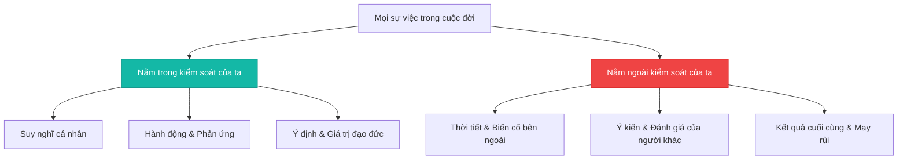

> [!abstract] Khung tư tưởng Khắc kỷ
> Chủ nghĩa Khắc kỷ (Stoicism) không phải là sự kìm nén cảm xúc một cách vô cảm, mà là một hệ thống tư duy thực hành nhằm đạt tới sự bình an nội tâm (*Ataraxia*) thông qua lý trí và sự phân biệt rõ ràng những gì nằm trong quyền kiểm soát của ta.

## 1. Nguyên lý phân đôi quyền kiểm soát (Dichotomy of Control)

Được đúc kết rõ nét nhất bởi triết gia Epictetus:

> *"Trong cuộc sống, có những thứ nằm trong tầm kiểm soát của chúng ta, và có những thứ không nằm trong tầm kiểm soát của chúng ta."*

## 2. Bốn phẩm hạnh cốt lõi (The 4 Cardinal Virtues)

1. **Trí tuệ (Wisdom)**: Khả năng điều hướng các tình huống phức tạp một cách logic và sáng suốt.
2. **Dũng cảm (Courage)**: Đối mặt với nỗi sợ hãi, khó khăn và kiên định với lẽ phải.
3. **Công bằng (Justice)**: Đối xử nhân hậu và công bằng với mọi người xung quanh.
4. **Tiết độ (Temperance / Moderation)**: Tự chủ, kỷ luật và kiểm soát ham muốn bản thân.

---

## 3. Đọc tiếp

Từ khung lý thuyết này, bạn có thể tiếp tục tìm hiểu cuộc đời và những chiêm nghiệm sâu sắc của hoàng đế La Mã Marcus Aurelius qua tác phẩm [[meditations-marcus-aurelius|Suy ngẫm (Meditations)]].
