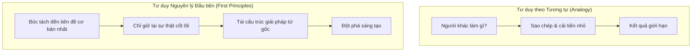

> [!quote] Elon Musk
> *"Tôi nghĩ cách tiếp cận tốt nhất là tư duy từ nguyên lý đầu tiên (first principles) — bóc tách vấn đề về những chân lý cơ bản nhất mà bạn chắc chắn là đúng, rồi lập luận đi lên từ đó."*

## 1. Tư duy từ Nguyên lý đầu tiên là gì?

Tư duy từ nguyên lý đầu tiên (**First Principles Thinking** hay *Reasoning from First Principles*) là hành động bóc tách một vấn đề phức tạp về những sự thật cơ bản nhất mà không thể nghi ngờ hay chia nhỏ hơn được nữa, rồi từ đó xây dựng lại lập luận và giải pháp đi lên từ con số không.

Trái ngược với nó là **Tư duy theo phép tương tự (Reasoning by Analogy)** — tức là làm theo những gì người khác đã làm, chỉ thêm bớt hoặc sao chép với một vài biến thể nhỏ.

---

## 2. Các bước thực hành cốt lõi

1. **Xác định và làm rõ các giả định hiện có**: Điều gì ta đang mặc nhiên coi là đúng?
2. **Truy vấn tới tận cùng bằng phương pháp Socrates**:
   - Tại sao điều này lại xảy ra?
   - Bằng chứng nào chứng minh cho điều đó?
   - Có thể có cách giải thích nào khác không?
3. **Tìm ra các nguyên lý bất biến (Axioms)**: Những sự thật tối giản mà khoa học/thực tế không thể phủ nhận.
4. **Xây dựng giải pháp mới từ các nguyên lý đó**: Không sao chép các mô hình cũ đã lỗi thời.

---

## 3. Mỏ neo cho tư duy logic

Bất kể bạn nghiên cứu về triết học khắc kỷ, khoa học máy tính hay kinh doanh, tư duy từ nguyên lý đầu tiên là chiếc mỏ neo vững chắc nhất để bạn đánh giá mọi lập luận và khám phá những giải pháp mới.
